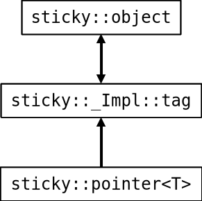

# `hmw::sticky`

This library is designed to implement "pointers" to an object that moves. The intended use is game development with plain C++, where entities in the game are stored in a list (e.g. `std::vector`) and can be added to / removed from the list at whim.  If the entity class is derived from `sticky::object`, then a `sticky::pointer` can be used to point to the entity, regardless of where it sits in the list.

Sticky pointers also try to eliminate use-after-free situations, by nullifying itself once an object is destroyed.  See [How It Works](#how-it-works) for more details.

## Usage

Same as any other library; header is in `./include` and static library shows up in `./build`

The provided code below is only an example; it does not work on its own, and does not provide implementations.  This just shows how you can use a sticky pointer to an object & never worry about it invalidating before the object is destroyed.

```c++
#include "/path/to/hmw/sticky.hpp"
#include <vector>

using namespace hmw;

/**
 * A base class for entities
 */
class Entity : public sticky::object {
  public:
    float x, y;

    Entity (float x, float y);

    bool touches (Entity* that);
};

/**
 * A player class
 */
class Player : public Entity {
  public:
    float health = 100.0;

    Player (float x, float y);

    void move ();
};

/**
 * A monster that follows a specific player
 */
class Monster : public Entity {
  public:
    sticky::pointer<Player> target;

    Monster (float x, float y, Player& t);

    void follow ();
};

// Create a list of players
std::vector<Player> players = {
  Player (100.0, 200.0),
  Player (-50.0, 350.0)
};

// Create a monster that follows player #2
Monster bobert (0.0, 0.0, players[1]);

// Adding a new player won't affect which object the monster follows,
// even if its index changes or the list reallocates
players.insert (
  players.begin (),
  Player (0.0, -150.0)
);

bobert.follow ();

// Clearing the list removes ALL players, but doesn't
// produce UB if a sticky pointer is dereferenced.
players.clear ();

// The implementation of `follow` should include a null check,
// since dereferencing a null sticky pointer will throw.
bobert.follow ();
```

## Authorship

All code was written by HMWBTE, absolutely no code was generated by an LLM. Claude Sonnet 5.5 was used to explain how implicit move assignment operators work with polymorphic classes, because the official C++ documentation stinks.

See `LICENSE.md` for this library's license.

## How it works



Derive your classes from `sticky::object` if you wish to have a sticky pointer to them.  This base class keeps a pointer to a stationary `tag` object, which in turn holds a pointer back to the instance of `sticky::object`.  When an object is moved, copied, or destructed, its corresponding `tag` gets updated with a new pointer, thereby keeping it up-to-date.  A `sticky::pointer<T>` object also stores a pointer to a `tag`, and checks it to learn when the pointed-to-object is deleted.

Both a `tag` object and a `sticky::pointer` object hold extra information beyond a pointer, for the sake of efficiency.  This data includes (but is not limited to) a **generation** (or recycle) count and a **revision** (or move) count.

Because this library tries not to leak memory, tags to deleted object are placed in a pool & recycled when available.  This lets them remain in (mostly) contiguous memory, while still having a constant address.  However, recycling tags introduces the problem of deprecated (but still working!) pointers.  To fix this, the **generation** value is increased whenever a tag is released.  A `sticky::pointer` object will always check its expected **generation** against the tag's generation when dereferencing.

The **revision** value, on the other hand, tracks when a `sticky::object` is moved and its address is changed.  This exists soley for the sake of caching the dynamic-cast pointer inside a `sticky::pointer` object and reducing the overhead of dereferencing an object that hasn't moved.  If **revision** doesn't match what a `sticky::pointer` remembers, then its cached pointer & expected **revision** value are updated.